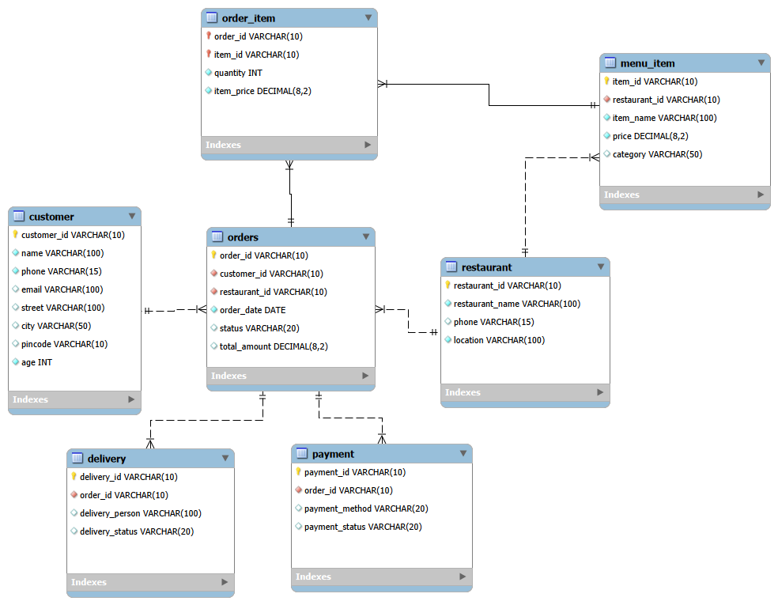

# Food Delivery SQL Project

A MySQL database for a food delivery app, built to practise SQL. It covers database design, data cleaning, data quality checks and business analysis queries.

> **Note:** All data is sample data I created for learning. It is not real company data, so the findings below describe this sample only.
> I used AI as a tutor to review my work and check for errors, and wrote and ran the queries myself.

## Database design

7 tables:

| Table | What it stores |
|---|---|
| Customer | Customer details (name, phone, address, age) |
| Restaurant | Restaurant name and location |
| Menu_Item | Items each restaurant sells, with price |
| Orders | One row per order (customer, restaurant, date, status, total) |
| Order_Item | The items inside each order, with quantity and price at the time of order |
| Payment | One payment per order (UPI, Cash or Card) |
| Delivery | One delivery per order, with delivery person and status |

**Design choice:** `Order_Item` is a separate table because one order can have many items. It stores `item_price` so old orders keep the price paid, even if the menu price changes later.

## The data

- 23 customers, 20 restaurants, 45 menu items
- 57 orders from July to October 2026, with 91 order item rows
- Repeat customers, multi-item orders, cancelled orders and refunds
- A few customers and restaurants with no orders, on purpose, to practise LEFT JOIN

## Data quality

I wrote queries to check my own data and found problems that I fixed:
- 3 orders whose total did not match their items
- 1 order containing an item from a different restaurant
- Order, payment and delivery statuses that disagreed with each other
- 1 delivery record missing after a DELETE practice

I then wrote 10 data quality checks (DQ1 to DQ10). All of them now return the expected result.

## SQL skills used

- DDL: CREATE, ALTER, constraints (PRIMARY KEY, FOREIGN KEY, CHECK, UNIQUE, DEFAULT)
- DML: INSERT, UPDATE, DELETE
- Joins: INNER, LEFT and RIGHT, including 3-table and 5-table joins
- Aggregates: COUNT, SUM, AVG, MIN, MAX with GROUP BY and HAVING
- CASE statements, one subquery (percentage of total), views

## Key findings (sample data)

1. 48 of 57 orders (84%) were delivered, earning 15100.
2. Biryani Point (2100) and Royal Kitchen (2090) are almost tied for top revenue.
3. 18 of the 20 customers who ordered placed 2 or more orders, and the top 5 customers made about 51% of delivered revenue.
4. UPI is the most used payment method (47%).
5. Refunds are about 7% of total order value (1210 of 17560), all from cancelled orders.
6. 53% of orders are medium value (200 to 399).

What surprised me most was how much the answers changed as I added data. With my first 20 orders Royal Kitchen led on revenue, but with 57 orders Biryani Point took the top spot, and the two are only 10 apart (2100 vs 2090). I also saw that Punjabi Rasoi has the highest average order value (440), but from just one order, so I learned to read an average together with the order count.

## Project files

| File | Purpose |
|---|---|
| 01_schema.sql | Creates the database and tables |
| 02_sample_data.sql | Original sample data |
| 03_alter_dml_practice.sql | ALTER, UPDATE and DELETE practice |
| 04_fixes_and_more_data.sql | Data fixes and extra data |
| 05_analysis_queries.sql | Data quality checks and business queries, with expected results |
| 06_views.sql | Views |

## How to run

Requires MySQL 8.0.19 or higher (check with `SELECT VERSION();`).

1. Run files 01, 02, 03, 04 and 06, in that order.
2. Check the counts: Orders = 57 and Order_Item = 91.
3. Open 05 and run the queries one at a time. Each query has its expected result written under it.

## What I learned

The most useful thing I learned was to check my own data before analysing it. My data checks found orders whose totals didn’t match their items, an item listed under the wrong restaurant, and statuses that disagreed between tables, so I fixed them first. I also learned that most query mistakes came from joining the wrong tables or forgetting GROUP BY, and I started asking “which table holds this data?” before writing a query. LEFT JOIN with IS NULL and the difference between WHERE and HAVING finally made sense when I used them on real questions. Next, I would add order timestamps to look at peak hours and delivery times, and build a small dashboard on the views.

## Next steps

- Add order timestamps, so peak hours and delivery time can be analysed
- Build a simple dashboard on top of the views
- Add a second project (sales or HR) to practise different business questions
